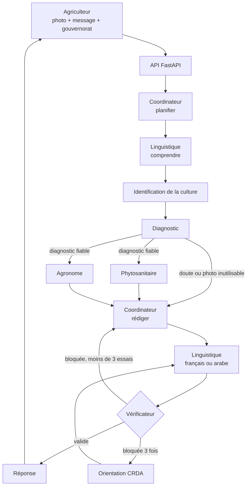

# AgrIA

**Un médecin des plantes pour les agriculteurs tunisiens.** L'agriculteur photographie une feuille ou un fruit malade et décrit ce qu'il voit. AgrIA reconnaît la culture, dit s'il s'agit d'une maladie ou d'une carence, puis propose uniquement des **traitements homologués en Tunisie** (dose, délai avant récolte), des engrais adaptés au sol de son gouvernorat et le besoin en eau du mois. Les réponses sont en **français ou en arabe**.

AgrIA est un **système multi-agents** : sept agents spécialisés, orchestrés avec LangGraph, travaillent sur un même dossier. Un agent Vérificateur contrôle chaque réponse avec des règles codées avant de l'envoyer. **Dans le doute, AgrIA ne recommande rien** : il pose des questions ou oriente l'agriculteur vers le CRDA (Commissariat régional au développement agricole).

> Statut : prototype de recherche (étape 4 sur 4). Les agents, l'API et l'application web fonctionnent. Il reste à construire un jeu de test de photos tunisiennes et à faire l'évaluation finale.

---

## Sommaire

- [Fonctionnalités](#fonctionnalités)
- [Architecture](#architecture)
- [Modèles et résultats](#modèles-et-résultats)
- [Sécurité des réponses](#sécurité-des-réponses)
- [Installation](#installation)
- [Utilisation](#utilisation)
- [API](#api)
- [Tests et évaluation](#tests-et-évaluation)
- [Structure du dépôt](#structure-du-dépôt)
- [Données et licences](#données-et-licences)
- [Limites connues](#limites-connues)
- [Documentation](#documentation)

---

## Fonctionnalités

- **Diagnostic sur photo** : maladies (51 classes), carences (9 nutriments) et fruits (18 classes). Un routeur sépare d'abord les feuilles, les fruits et les autres photos.
- **Reconnaissance de la culture** parmi les 14 cultures du projet : tomate, olivier, agrumes, poivron, pomme de terre, vigne, palmier dattier, blé, maïs, pommier, pêcher, cerisier, fraisier, courge. La culture est **proposée** et l'agriculteur la confirme.
- **Distinction carence ou maladie** : un modèle « feuille » appris sur les deux à la fois. Un jaunissement ou une décoloration n'est pas confondu avec une tache ou une moisissure.
- **Combinaison de modèles et VLM** : plusieurs modèles votent, et un modèle de vision (VLM) donne un deuxième avis, qui sert de contrôle et de secours.
- **Traitements homologués** d'après la liste officielle tunisienne (22/05/2024), avec la dose, le délai avant récolte (DAR), les limites de résidus de l'UE (LMR) et les restrictions.
- **Engrais** adaptés à la carence, à la culture et au sol du gouvernorat (SoilGrids), et **besoin en eau** selon la méthode FAO-56 (Open-Meteo).
- **Compréhension du message** en français, en arabe, en darija et en arabizi. **Réponse** en français ou en arabe, écrite de droite à gauche pour l'arabe.
- **Application web responsive** (téléphone et ordinateur) : photo prise avec l'appareil, culture pré-remplie, 3 propositions en boutons, et la trace « Comment AgrIA a décidé ».
- **Explicabilité** : chaque agent ajoute une ligne à la trace (qui, quoi, durée).

---

## Architecture

| Agent | Rôle | S'appuie sur |
|---|---|---|
| **Coordinateur** | planifie le cas, assemble les résultats, rédige la réponse ; la réécrit si elle est bloquée, puis oriente vers le CRDA | règles, `redaction.py` |
| **Linguistique** | comprend le message (culture, symptômes, gouvernorat) et écrit la réponse en français ou en arabe | lexique, phrases écrites par le code |
| **Identification de la culture** | reconnaît la plante sur la photo et la propose à l'agriculteur | vote du modèle de culture et du modèle des maladies, VLM en contrôle et en secours |
| **Diagnostic** | dit si c'est une carence ou une maladie, puis donne la classe ; décide si le diagnostic est fiable | routeur, modèle feuille, modèle des maladies restreint à la culture, VLM |
| **Phytosanitaire** | choisit les traitements homologués et les conseils des fiches | base SQLite, recherche TF-IDF |
| **Agronome** | propose les engrais d'une carence et calcule le besoin en eau du mois | base SQLite, FAO-56 |
| **Vérificateur** | contrôle la réponse finale et la bloque si une règle n'est pas respectée | 12 règles bloquantes codées |



Phytosanitaire et Agronome travaillent en parallèle.

**Pas de LLM pour écrire les réponses.** Toutes les phrases sont écrites par le code (`src/agent/redaction.py`) : aucun produit, aucune dose, aucun délai ne peut être inventé ou mal traduit. Un essai avec un petit LLM local l'a montré : il changeait des doses (« 300 g/hl » devenait « 300 g/l »). Le seul modèle de langage du projet est un VLM optionnel. Il **regarde** la photo et donne un avis (culture, type de problème, symptômes), mais il n'écrit jamais la réponse et ne choisit aucun produit.

---

## Modèles et résultats

Tous les modèles sont des EfficientNet-B0 entraînés en local, sur une NVIDIA RTX 2050 (4 Go). Pour chaque tâche, le modèle est choisi sur la validation. Le test sert uniquement à mesurer.

| Modèle | Tâche | Test laboratoire | Photos de terrain (test, avant → après l'ajout de photos de terrain) |
|---|---|---|---|
| Routeur | feuille, fruit ou autre | 99,8 % | — |
| Maladies (s300, 22/11) | 51 classes | 99,4 % | 52,9 → 80,1 → **82,8 %** (703 photos) ; PlantDoc seul 61,9 → 71,6 → 75,6 % |
| Feuille (s300, 22/11) | 51 maladies + 9 carences | 97,0 % ; type de problème (carence ou maladie) 97,3 % | 50,9 → 78,5 → **81,4 %** (703 photos) |
| Fruits | 18 classes | 98,3 % (macro-F1 0,897) | — |
| Culture (v4) | 14 cultures + « autre plante » | 99,9 % | 58,9 → **94,3 %** (1 861 photos) |

Les photos de terrain de PlantWild, de pommes de terre au champ et de vignes (GVLiD) ont été ajoutées le 20/11/2026. Les gains sur ces sources sont optimistes, car leur test vient de la même source que leur entraînement. Sur PlantDoc, source inchangée, le modèle des maladies gagne 9,7 points (McNemar p = 0,008).

**Combinaison utilisée par les agents.** Les poids sont appris sur la validation. Les chiffres donnent : culture juste / culture fausse avec une confiance d'au moins 85 %. Mêmes jeux de test avant et après.

| Décision de l'agent (vote + VLM) | Labo (358) | Terrain (703) | Nouvelles sources (216) | Photos d'Internet (15) |
|---|---|---|---|---|
| anciens modèles | 98,6 / 0 | 78,0 / 2,0 | 96,8 / 0 | 66,7 / 0 |
| modèles avec photos de terrain (20/11) | 97,2 / 0 | 88,9 / 0,4 | 97,2 / 0 | 100 / 0 |
| **modèles en taille 300 (22/11)** | 97,5 / 0 | **89,2 / 0,6** | 97,7 / 0 | **100 / 0** |

Avec les nouveaux modèles, le choix entre carence et maladie est juste dans 99,9 % des cas sur les photos de terrain. La chaîne complète (culture, puis type de problème, puis classe) est juste dans 97,2 % des cas sur les photos de laboratoire et dans **80,8 %** des cas sur les photos de terrain (55,2 % avant les photos de terrain, 78,2 % avant les modèles en taille 300).

**Plan d'amélioration sur le terrain (21–22/11/2026).** Les modèles maladies et feuille passent en taille 300 avec label smoothing et EMA. Sur le terrain : maladies 82,8 % (McNemar p = 0,023), feuille 81,4 % (p = 0,023), et une confiance fiable (ECE 0,14 → 0,05–0,06). Les seuils de l'agent sont revus sur la confiance de la combinaison : maladies 0,9 → 0,8, avec autant de photos répondues et 93,7 % de réponses justes au lieu de 92,7 % ; carences 0,95 → 0,7, avec la même exactitude qu'avant (98,5 %). Le recadrage sur la feuille, les augmentations « terrain » et les modèles de fondation gelés (DINOv2, BioCLIP) ont été mesurés mais pas installés. Le leave-one-source-out montre qu'une source jamais vue tombe vers 37–52 %. L'application demande maintenant l'accord de l'agriculteur avant de garder sa photo, pour constituer un jeu de test tunisien gelé (`data/field_tn/`). Le détail est dans la section 15 de [docs/results_vision.md](docs/results_vision.md), et le journal des expériences dans [docs/experiments.csv](docs/experiments.csv).

Le détail est dans [docs/results_vision.md](docs/results_vision.md) : comparaison CNN et ViT, hypothèses H1 à H3, seuils de confiance, combinaison et VLM.

---

## Sécurité des réponses

Deux principes ne sont jamais cassés :

1. **Aucun produit n'est inventé.** Les produits et les engrais viennent des listes officielles et sont choisis par le code.
2. **Dans le doute, rien n'est recommandé.** AgrIA pose une question ou oriente vers le CRDA.

L'agent Vérificateur bloque une réponse si elle contient :

- un pesticide non homologué pour cette maladie ou pour cette culture, même s'il est seulement cité dans le texte ;
- une dose différente de la dose homologuée ;
- un délai avant récolte différent de la liste officielle, ou un délai alors que la liste n'en donne pas ;
- un produit ou un engrais pour une plante saine ;
- un produit alors que le diagnostic n'est pas fiable ;
- une carence jamais vue sur cette culture et non présentée comme une hypothèse ;
- un engrais absent du catalogue de cette carence ;
- un produit dont la dose homologuée n'est pas écrite sur la même ligne que lui.

Aucun traitement n'est proposé sans culture confirmée. Le VLM ne peut pas contredire la culture donnée par l'agriculteur. Les produits réservés aux campagnes nationales ne sont jamais proposés.

---

## Installation

Prérequis : Python 3.9 ou plus récent, et de préférence un GPU NVIDIA (CUDA 12.6). Sans GPU, tout fonctionne sur CPU, plus lentement.

```bash
git clone <url-du-depot> AgrIA
cd AgrIA
python -m venv .venv
.venv\Scripts\activate            # Windows ; sous Linux ou macOS : source .venv/bin/activate

# Avec un GPU NVIDIA, installer d'abord PyTorch pour CUDA :
pip install torch==2.8.0 torchvision==0.23.0 --index-url https://download.pytorch.org/whl/cu126
pip install -r requirements.txt
```

**Données et modèles.** Les dossiers `data/` et `models/` ne sont pas dans Git, à cause de leur taille et des licences des jeux d'images. Pour lancer l'application, il faut :

- `models/` : routeur, maladies, carences, fruits, feuille et culture, chacun avec `model.pt`, `labels.json` et `metrics.json` ;
- `data/processed/` : les tables propres (traitements, engrais, climat, sols, lexique, fiches). La base SQLite `data/processed/agria.db` est reconstruite automatiquement au premier appel.

Sources et préparation : [data/README.md](data/README.md) et [docs/ARCHITECTURE.md](docs/ARCHITECTURE.md), section 3.

**VLM (optionnel).** Créez un fichier `.env` à la racine du projet. Il est ignoré par Git et ne doit jamais être commité.

```text
NVIDIA_API_KEY=nvapi-...
```

---

## Utilisation

```bash
python -m uvicorn src.api.main:app --host 0.0.0.0 --port 8000
```

- Application : http://localhost:8000. Sur un téléphone connecté au même Wi-Fi : `http://<IP de l'ordinateur>:8000`.
- Documentation interactive de l'API : http://localhost:8000/docs

| Variable | Rôle | Valeur par défaut |
|---|---|---|
| `AGRIA_VLM=nvidia` | active le deuxième avis du VLM (clé dans `.env`) | désactivé |
| `AGRIA_VLM_MODEL` | modèle de vision NVIDIA | `nvidia/nemotron-3.5-super-vl-120b-a12b` |
| `AGRIA_DEVICE` | `cuda` ou `cpu` | détection automatique |
| `AGRIA_JOURNAL=1` | **mode test uniquement** : garde chaque analyse et l'avis du testeur dans `data/journal/` | désactivé |
| `AGRIA_CROP_MODEL` | dossier du modèle de culture dans `models/` | `crop` |

**Vie privée.** Par défaut, la photo est écrite dans un fichier temporaire, lue par les modèles, puis supprimée : rien n'est conservé. Le mode journal ne doit jamais être activé pour de vrais utilisateurs sans leur accord.

---

## API

| Méthode | Route | Rôle |
|---|---|---|
| `POST` | `/identify` | photo → culture proposée, confiance, 3 propositions, avis de chaque modèle et du VLM |
| `POST` | `/diagnose` | photo, message, gouvernorat, culture, langue (`fr` ou `ar`), mois → réponse complète des agents : diagnostic, produits, engrais, eau, questions, sources, vérification, trace |
| `POST` | `/feedback` | avis du testeur sur une analyse (mode journal) |
| `GET` | `/cultures` | les 14 cultures, en français et en arabe |
| `GET` | `/gouvernorats` | les 24 gouvernorats, en français et en arabe |
| `GET` | `/health` | modèles chargés, appareil utilisé |

```bash
curl -F "photo=@feuille.jpg" -F "message=taches brunes sur les feuilles" \
     -F "gouvernorat=Nabeul" -F "culture=tomato" -F "langue=fr" \
     http://localhost:8000/diagnose
```

---

## Tests et évaluation

```bash
python -m unittest discover -s tests -t .      # 117 tests : outils, agents, API, évaluation, préparation
```

| Commande | Ce qu'elle mesure |
|---|---|
| `python src/vision/evaluate.py --task diseases --model-dir models/diseases --splits val test test_field` | un modèle, sur le laboratoire et le terrain |
| `python src/vision/calibrate.py --task diseases --model-dir models/diseases` | seuils de confiance |
| `python src/evaluation/compare.py --new models/diseases_s300 --current models/diseases --change "taille 300"` | deux modèles sur les mêmes photos : exactitude, macro-F1, ECE, McNemar (`reports/compare/`) |
| `python src/evaluation/loso.py --task diseases --sources plantdoc plantwild potato_field --epochs 5` | leave-one-source-out : chaque source de terrain jamais vue à l'entraînement |
| `python src/evaluation/temperature.py --task diseases` | température, couverture et exactitude selon le seuil (`reports/temperature/`) |
| `python src/agent/eval_ensemble.py --tune --vlm` | apprend les poids de la combinaison sur la validation, puis évalue sur tous les jeux de test (`docs/eval_ensemble_vlm.md`) |

---

## Structure du dépôt

```text
AgrIA/
├── src/
│   ├── acquisition/   inventaire des images
│   ├── preparation/   collecte, nettoyage, doublons, ajout de sources, équilibrage, EDA
│   ├── vision/        entraînement, évaluation, calibration et prédiction des modèles d'images
│   ├── tools/         outils des agents : traitements, engrais, eau, recherche dans les fiches, lexique, contrôle
│   ├── agent/         système multi-agents (LangGraph) : dossier partagé, graphe, agents, rédaction, combinaison, VLM
│   ├── api/           API FastAPI
│   └── app/           application web responsive (HTML, CSS, JavaScript, installable sur le téléphone)
├── tests/             tests unitaires par module
├── docs/              architecture, rapports de résultats, tables de correspondance, figures
├── notebooks/         vérification des données
├── data/              hors Git
└── models/            hors Git
```

---

## Données et licences

| Source | Utilisation |
|---|---|
| PlantVillage, PlantDoc, OLID I | images de maladies et de carences (laboratoire et terrain) |
| Jeux de carences : poivron, maïs (Mendeley), tomate (Mendeley, Tomato-Village), CitrusUAT (Zenodo) | carences des cultures du projet |
| Jeux d'olivier et d'agrumes (dont lemon_bd) | reconnaissance de la culture |
| PlantWild v2 (CC BY-NC-ND 4.0), pommes de terre au champ (Mendeley, CC BY 4.0), GVLiD vigne (Mendeley, CC BY 4.0) | photos de terrain ajoutées le 20/11/2026 ; GVLiD pour la culture seulement |
| Liste des pesticides homologués en Tunisie (Ministère de l'Agriculture, 22/05/2024) | traitements, doses, délais avant récolte |
| Base de données des pesticides de l'UE | limites maximales de résidus |
| agrishop, agriclic | engrais : composition et doses |
| Open-Meteo, SoilGrids, FAO-56 | climat, sols, besoins en eau |
| Fiches techniques (INRAT, FAO) | conseils et recherche dans les fiches |

Chaque jeu garde sa propre licence. La plupart sont en CC BY 4.0. **Tomato-Village n'a pas de licence** dans son dépôt : il faut citer ses auteurs (Gehlot, Saxena et Gandhi, *Multimedia Systems*, 2023). Le détail est dans [docs/results_vision.md](docs/results_vision.md), section 11, et dans [data/README.md](data/README.md).

**Règles sur les données :**

- ne jamais lancer `prepare_images.py` ;
- ajouter une source uniquement avec `add_source.py` ;
- retirer une image uniquement avec `remove_images.py` ;
- ne jamais modifier une ligne d'un manifest à la main ;
- ne jamais équilibrer la validation ni le test.

---

## Limites connues

- **Photos de terrain.** Les modèles ont surtout appris sur des photos de laboratoire. Sur le terrain, le diagnostic exact de la maladie était d'environ 62 % ; avec les photos de terrain ajoutées et la taille 300, il atteint 83 % sur le test terrain et 76 % sur PlantDoc, mais une source jamais vue tombe vers 37–52 % (leave-one-source-out), d'où les seuils de l'agent et les questions de confirmation. La vraie mesure viendra des photos tunisiennes gardées avec l'accord des agriculteurs (`data/field_tn/`).
- **Peu de photos tunisiennes.** L'olivier, le palmier et les agrumes ont moins d'images et des sources peu variées. Le modèle apprend en partie le style des photos de chaque source. Un jeu de test de photos tunisiennes reste à construire.
- **Carences de certaines cultures.** Aucun jeu public n'existe pour l'olivier, la vigne, la pomme de terre et les arbres fruitiers : leurs carences sont toujours présentées comme des hypothèses.
- **VLM.** Il est faible sur les photos de laboratoire et très bon sur les photos d'Internet. Son seuil de secours a été réglé en partie sur un petit échantillon de 15 photos. Il ajoute environ 8 secondes par nouvelle photo et dépend du service NVIDIA.
- **Arabe.** Les phrases en arabe sont à faire relire par un locuteur natif (`docs/validation_langue.xlsx`).

---

## Documentation

| Document | Contenu |
|---|---|
| [docs/ARCHITECTURE.md](docs/ARCHITECTURE.md) | agents, contrats entre modules, données, plan de travail, décisions |
| [docs/results_vision.md](docs/results_vision.md) | modèles d'images, hypothèses H1 à H3, seuils, modèle feuille, modèle de culture, combinaison et VLM |
| [docs/results_routing.md](docs/results_routing.md) | routeur (feuille, fruit, autre) |
| [docs/results_tools.md](docs/results_tools.md) | base de données, outils des agents, règles du Vérificateur |
| [docs/eval_ensemble_vlm.md](docs/eval_ensemble_vlm.md) | évaluation complète de la combinaison de modèles avec le VLM |

---

## Auteur

Projet réalisé par **Maissene Jradi**.

Licence du code : à définir. Les données et les modèles ne sont pas distribués avec ce dépôt.
