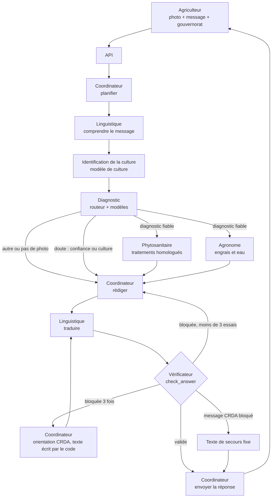

# AgrIA : architecture et plan de travail

Ce document dit ce que nous construisons et dans quel ordre. Tout le projet est réalisé par Maissene, en local.
Les données sont prêtes. Il reste à construire les modèles, les outils de l'agent et l'application.

Le travail est **séquentiel** : une étape commence quand la précédente a coché sa liste « Livré quand ».

| Étape | Travail | Reçoit | Livre | État |
|---|---|---|---|---|
| 1 | Socle d'entraînement + routeur | Données préparées | Scripts `src/vision/`, routeur entraîné | ✅ |
| 2 | Modèles de diagnostic | Scripts et données | 3 modèles entraînés, rapport d'évaluation | ✅ (essais terrain en cours) |
| 3 | Outils de l'agent | Noms de classes, tables propres | Base de données, outils testés, RAG | ✅ (88 termes darija à valider) |
| 4 | Système multi-agents, API, application | Modèles + outils | Application de démonstration, évaluation finale | en cours (agents, API et app faits ; jeu de test et mesures finales à faire) |

---

## 1. Vue d'ensemble : un système multi-agents

AgrIA est un **système de sept agents** qui coopèrent autour d'un dossier partagé (`src/agent/state.py`), orchestrés avec LangGraph (`src/agent/graph.py`).

| Agent | Rôle | Outils | Fonctionne avec |
|---|---|---|---|
| **Coordinateur** | planifie le cas, assemble les résultats, écrit la réponse, la réécrit si elle est bloquée (2 fois au plus), sinon oriente vers le CRDA | `redaction.py` | règles |
| **Linguistique** | comprend le message (français, arabe, darija, arabizi) : culture, symptômes, gouvernorat, contexte de la parcelle (récolte, marché, bio, serre, stade) ; écrit la réponse en français ou en arabe, avec au plus 3 questions de contexte quand la réponse en dépend | `normalize_terms`, `crop_code`, `redaction.py` | lexique + phrases écrites par le code |
| **Identification de la culture** | reconnaît la plante sur la photo (14 cultures du projet ou « autre plante ») ; sans culture indiquée, la culture reconnue limite le diagnostic ; si la photo contredit nettement la culture indiquée, ou si elle est incertaine, une question est posée | `ensemble.crop_decision`, `vlm.observe` | vote du modèle de culture (v4, 15 classes), du modèle des maladies et du VLM (poids 0,25) ; VLM NVIDIA aussi en contrôle et en secours (`AGRIA_VLM=nvidia`) |
| **Diagnostic** | lit la photo (routeur puis modèle maladies, carences ou fruits) ; décide si le diagnostic est fiable, sinon pose des questions | `predict()`, `ensemble.kind_share` | routeur + combinaison : modèle feuille (carence ou maladie) + avis du VLM, puis modèle des maladies restreint à la culture ou carence du modèle feuille |
| **Phytosanitaire** | choisit les traitements homologués (dose, DAR, LMR, restrictions), écarte ceux qui ne conviennent pas à la situation (DAR plus long que la récolte, export UE, bio), classe les autres par un score écrit en code avec une ligne « pourquoi », et des conseils des fiches sans aucune lutte chimique | `get_treatments`, `ranking.rank`, `ranking.decisive_fields`, `search_knowledge`, `prevention` | base SQLite + règles + recherche TF-IDF |
| **Agronome** | engrais pour une carence (fiabilité selon la culture, sol du gouvernorat) et besoin en eau du mois | `get_fertilizers`, `get_water_need` | base SQLite + règles |
| **Vérificateur** | contrôle la réponse finale, dans la langue du fermier ; la bloque et la renvoie au Coordinateur | `check_answer` | **12 règles codées** |

**Pas de LLM pour écrire.** Le seul modèle de langage est un VLM (NVIDIA, optionnel) qui **regarde** la photo et donne un avis (culture, carence ou maladie, symptômes) ; il n'écrit jamais la réponse, ne choisit aucun produit et ne peut pas contredire la culture donnée par l'agriculteur (docs/results_vision.md, section 13). AgrIA répond en **français ou en arabe** (pas de darija). Toutes les phrases sont écrites par le code (`src/agent/redaction.py`), donc aucun fait (produit, dose, délai) ne peut être inventé ni mal traduit. Un essai avec un petit LLM local (`derja`, Qwen3 4B, Ollama) l'a montré : il changeait des doses (« 300 g/hl » devenu « 300 g/l ») et traduisait mal les termes agricoles. Dans une réponse en arabe, les passages des fiches (français ou anglais) sont remplacés par leurs liens.



Phytosanitaire et Agronome travaillent **en parallèle**. Chaque agent ajoute une ligne à la trace de la réponse (qui, quoi, durée), ce qui permet d'expliquer chaque réponse.

**Deux principes à ne jamais casser :**

1. **Aucun produit n'est inventé.** Les produits et les engrais sont choisis en code par les agents Phytosanitaire et Agronome, à partir des listes officielles ; le texte est écrit par le code ; l'agent Vérificateur contrôle le texte final avec des règles codées.
2. **Dans le doute, l'agent ne recommande rien** : il pose une question ou transmet le cas au CRDA.

---

## 2. Organisation du dépôt

Ce qui existe déjà est marqué ✅. Le reste est à créer.

```text
AgrIA/
├── src/
│   ├── acquisition/      ✅ inventaire des images
│   ├── preparation/      ✅ collecte, nettoyage, équilibrage, EDA
│   ├── vision/           ✅ Étapes 1 et 2 : entraînement et prédiction
│   │   ├── dataset.py       lecture des manifests, transformations
│   │   ├── train.py         entraînement d'une tâche
│   │   ├── evaluate.py      scores globaux, par classe, par culture, terrain
│   │   └── predict.py       interface utilisée par l'agent
│   ├── tools/            ✅ Étape 3 : outils des agents
│   │   ├── build_db.py      CSV propres vers base SQLite
│   │   ├── treatments.py    traitements homologués, dose, DAR, LMR
│   │   ├── fertilizers.py   engrais et règles de carences
│   │   ├── water.py         besoins en eau, prévisions météo
│   │   ├── rag.py           recherche dans les fiches
│   │   ├── lexicon.py       français, arabe, darija
│   │   └── safety.py        contrôle de la réponse finale
│   ├── agent/            Étape 4 : système multi-agents (LangGraph)
│   │   ├── state.py         dossier partagé entre les agents
│   │   ├── graph.py         graphe des agents, point d'entrée diagnose()
│   │   ├── redaction.py     réponse écrite par le code, en français ou en arabe
│   │   ├── make_validation_sheet.py  classeur de relecture de l'arabe (docs/validation_langue.xlsx)
│   │   └── agents/          coordinateur, linguistique, diagnostic, specialistes (phyto + agronome), verificateur
│   ├── api/              ✅ Étape 4 : API FastAPI (main.py)
│   └── app/              ✅ Étape 4 : application web responsive (index.html, app.js, style.css)
├── tests/                un dossier de tests par module
├── docs/                 ✅ rapports, figures, tables de correspondance
├── data/                 ✅ hors Git, en local (sauvegarde conseillée sur Drive)
└── models/               hors Git, en local (sauvegarde conseillée sur Drive)
```

---

## 3. Données disponibles

Le dossier `data/` n'est **pas sur GitHub**. Il reste sur la machine locale. **Tout s'exécute en local** (GPU NVIDIA si disponible, sinon CPU), pas sur Colab.

| Besoin | Fichier | Contenu |
|---|---|---|
| Train | `data/processed/balanced/<tâche>_train.csv` | Train équilibré des tâches `diseases`, `deficiency`, `fruits` |
| Poids des classes | `data/processed/balanced/<tâche>_class_weights.csv` | Pour la fonction de perte |
| Validation et test | `data/processed/<tâche>_manifest.csv` | Colonne `split` : `val`, `test`, et `test_field` pour les maladies |
| Routeur | `data/processed/routing_manifest.csv` | 15 985 photos, classes `leaf`, `fruit`, `other` |
| Test par culture | `data/processed/balanced/deficiency_test_by_crop.csv` | Mesure du biais des carences |
| Traitements | `docs/disease_target_mapping.csv` (lignes `validated`) appliqué à `data/processed/pesticides/tn_usages.csv` | Classe du modèle vers cible du registre, puis produit homologué (plan phyto, étape 2) |
| Prévention sans produit | `docs/conseils_prevention.csv` (lignes `validated`) | Conseils de prévention en français et en arabe pour les classes sans produit homologué |
| Réglementation | `data/processed/clean/pesticides_usages.csv`, `pesticides_usage_lmr.csv`, `eu_mrl.csv` | Usages, doses, LMR |
| Engrais | `data/processed/clean/carence_engrais.csv`, `engrais_catalogue.csv`, `engrais_usages.csv` | Carence vers engrais, composition, doses |
| Règles de carences | `data/processed/knowledge/regles_carences.json` | Questions de confirmation, règle de sol |
| Connaissances | `data/processed/knowledge/fiches.jsonl`, `lexique.csv`, `varietes_tn.csv` | RAG, langue, variétés |
| Contexte | `data/processed/context/` | Gouvernorats, climat, sols, besoins en eau |

**Règles sur les données**

- Ne jamais lancer `prepare_images.py` : il reconstruit tout et annule les retraits d'images.
- Ajouter une source uniquement avec `add_source.py`, retirer une image uniquement avec `remove_images.py`.
- Ne jamais modifier à la main une ligne d'un manifest.
- Ne pas ajouter d'images d'autres cultures pour corriger un biais.
- Ne jamais équilibrer la validation ni le test : ils gardent la distribution réelle.

---

## 4. Contrats entre les étapes

Ces interfaces séparent les modules : chaque partie se développe et se teste sans dépendre du code interne des autres. Toute modification d'un contrat est notée ici.

### Modèle vers agent : `src/vision/predict.py`

```python
predict(task: str, image_path: str) -> dict
# task : "routing", "diseases", "deficiency" ou "fruits"
# {
#   "task": "diseases",
#   "class": "tomato__late_blight",
#   "confidence": 0.93,
#   "top3": [["tomato__late_blight", 0.93], ["tomato__early_blight", 0.04], ...],
#   "reliable": True          # confiance au-dessus du seuil calibré
# }
```

Chaque modèle est livré dans `models/<tâche>/` avec `model.pt`, `labels.json` et `metrics.json`.
`labels.json` utilise exactement les noms de classes des manifests.

### Outils vers agent : `src/tools/`

```python
get_treatments(unified_class: str, crop: str | None) -> list[dict]
# produit, substances, dose, unité, DAR ou None, LMR, relation, restriction
get_fertilizers(deficiency: str, crop: str | None = None, governorate: str | None = None) -> dict
# produits, teneur, dose, niveau de fiabilité (« hypothese » hors culture vue), questions de confirmation, sol
get_water_need(governorate: str, crop: str, month: int, forecast: bool = False) -> dict
# ET0, Kc, besoin, pluie, déficit (mm et m³/ha), prévision 7 jours en option
search_knowledge(query: str, k: int = 3, classe: str | None = None) -> list[dict]
# extrait, fiche, section, langue, lien de la source, licence
normalize_terms(text: str) -> dict
# cultures, maladies, ravageurs, symptômes, organes reconnus en français, arabe, darija, arabizi ; classes possibles
check_answer(answer: dict) -> dict
# answer : task, classe, culture, fiable, hypothese, produits [{nom, dose, dar_jours}], engrais [{nom}], texte
# -> {valide, raisons (bloquantes), avertissements (à dire), produits_verifies}
```

Import : `from src.tools import get_treatments, ...`. Les noms de culture et de gouvernorat sont acceptés en français,
en arabe ou en arabizi. Détail et règles : `docs/results_tools.md`.

Une liste vide veut dire « aucun produit homologué », jamais une erreur.

### API vers application

```text
POST /diagnose
  entrée : photo, message, gouvernorat, culture (facultative), langue
  sortie : diagnostic, confiance, recommandation, sources, question ou transmission au CRDA
```

---

## 5. Détail des étapes

### Étape 1 · Socle d'entraînement et routeur

**Objectif :** entraîner n'importe quel modèle avec une seule commande.

1. **Garder les données hors Git.** `data/processed/` reste en local ; une archive de sauvegarde sur Drive est conseillée.
2. **Rendre les données lisibles sur toute machine.** Les chemins des manifests et de `balanced/*_train.csv` utilisent `\` (Windows) et ne fonctionnent pas tels quels sous Linux ou macOS. Les convertir à la lecture dans `dataset.py`, sans modifier les fichiers.
3. **Écrire `src/vision/dataset.py`** : lecture des CSV, transformations et normalisation identiques partout, sans augmentation supplémentaire qui change les teintes.
4. **Écrire `src/vision/train.py`** : `python src/vision/train.py --task routing --model efficientnet_b0`. Il doit gérer le modèle préentraîné, les poids de classes, l'arrêt anticipé et la graine fixe.
5. **Écrire `src/vision/evaluate.py`** : exactitude, macro-F1, matrice de confusion, scores par classe, par culture et sur `test_field`.
6. **Écrire `src/vision/predict.py`** selon le contrat ci-dessus.
7. **Entraîner et évaluer le routeur** : c'est le test de toute la chaîne.
8. **Mettre à jour `requirements.txt`** (`torch`, `torchvision`, `scikit-learn`, `tqdm`) avec la commande d'installation de PyTorch pour GPU NVIDIA (CUDA 12.6).

**Attention :** 92 % des fruits du routeur sont des grenades. Regarder le score sur les fruits de tomate et d'agrumes, pas seulement le score global.

**Livré quand :**
- [x] L'entraînement du routeur se relance avec une seule commande.
- [x] `models/routing/` contient `model.pt`, `labels.json`, `metrics.json`.
- [x] `predict("routing", "photo.jpg")` renvoie le format du contrat.
- [x] Les scores du routeur sont notés dans `docs/results_routing.md`.

### Étape 2 · Modèles de diagnostic

**Objectif :** trois modèles évalués honnêtement, surtout sur le terrain.

1. Entraîner dans cet ordre : `diseases`, `deficiency`, `fruits`.
2. Comparer un CNN (EfficientNet) et un ViT sur `diseases`, puis garder le meilleur compromis entre score et vitesse.
3. Comparer avec et sans jeu équilibré (hypothèse H3).
4. Mesurer le score sur les 199 photos de `test_field` (H1).
5. Mesurer les carences par culture avec `deficiency_test_by_crop.csv` (H2).
6. Calibrer le seuil de confiance de chaque modèle, qui alimente le champ `reliable`.

**Critères visés :** exactitude d'au moins 90 % sur le terrain, macro-F1 d'au moins 0,85. Si la cible n'est pas atteinte, le rapport le dit et propose une suite, comme le prévoit la boucle CRISP-DM.

**Livré quand :**
- [x] `models/diseases/`, `models/deficiency/`, `models/fruits/` existent (sauvegarde hors de la machine conseillée).
- [x] `predict()` fonctionne pour les quatre tâches.
- [x] `docs/results_vision.md` donne les scores globaux, par classe, par culture et terrain, avec les hypothèses H1 à H3.
- [x] Les seuils de confiance sont justifiés dans ce rapport.

### Étape 3 · Outils de l'agent

**Objectif :** des outils fiables, à base de règles et de tables, testés un par un.

1. `build_db.py` : charger les tables propres dans une base SQLite.
2. `treatments.py` : traitements par classe et culture, en préférant les liens `direct`, puis `vecteur`, `groupe` et `proche`.
3. `fertilizers.py` : engrais par carence, avec `regles_carences.json` et le pH du gouvernorat.
4. `water.py` : besoins en eau à partir de `besoins_eau_mensuels.csv`, prévisions avec `forecast_url()` de `fetch_context_tn.py`.
5. `rag.py` : recherche dans les fiches, chaque extrait gardant le lien de sa source. Choix fait : TF-IDF local (76 fiches, hors ligne, aucun modèle à télécharger) au lieu de Chroma, remplaçable derrière la même fonction.
6. `lexicon.py` : reconnaissance des termes. Les 88 entrées marquées `a_valider` sont relues avec un locuteur tunisien.
7. `safety.py` : bloquer toute réponse citant un produit hors de la liste homologuée.

**Cas à traiter explicitement :**
- 28 classes sur 48 n'ont aucun produit homologué : donner des conseils tirés des fiches, jamais un produit inventé.
- Le DAR manque pour 88 % des usages : répondre « délai non précisé, voir l'étiquette », ne jamais l'estimer.
- Zn, B et Ca ne sont vus que sur une culture, Fe presque uniquement sur le poivron : sur une autre culture, le résultat reste une hypothèse à confirmer.
- Respecter les colonnes `restriction` et `autorisation_provisoire`.

**Livré quand :**
- [x] Toutes les fonctions du contrat existent et ont des tests dans `tests/tools/`.
- [x] Les cas ci-dessus ont chacun leur test.
- [x] Un test vérifie que `safety.py` bloque un produit non homologué.
- [x] L'agent peut appeler chaque outil sans connaître la base.

### Étape 4 · Système multi-agents, API, application

**Objectif :** une démonstration complète, de la photo à la réponse.

1. ✅ Décision : application web responsive (téléphone et ordinateur).
2. ✅ `src/agent/` : les six agents et leur graphe LangGraph (section 1), 11 tests dans `tests/agent/`, dont un rédacteur fautif qui glisse un produit non homologué : bloqué 4 fois, puis texte de secours.
3. ✅ Réponses en français ou en arabe écrites par le code (`src/agent/redaction.py`), sans LLM. Arabe à relire avec `docs/validation_langue.xlsx`.
4. ✅ `src/api/main.py` (FastAPI) : `POST /identify` (culture reconnue sur la photo, pour pré-remplir le champ « Culture »), `GET /cultures`, `POST /diagnose`, `GET /gouvernorats`, `GET /health`, documentation sur `/docs` ; photo supprimée après l'analyse ; 6 tests dans `tests/api/`.
5. ✅ `src/app/` : application web responsive (téléphone et ordinateur) : photo prise avec l'appareil, message, gouvernorat, culture ; interface et réponse en français ou en arabe (de droite à gauche) ; « Comment AgrIA a décidé » montre la trace des agents. Lancement : `python -m uvicorn src.api.main:app --host 0.0.0.0 --port 8000`.
6. Importer le jeu de test de l'agent et mesurer le système complet.
7. Organiser le pilote : au moins 10 agriculteurs ou conseillers.

**Critères visés :** moins de 15 s de la photo à la réponse, 100 % de produits homologués, au moins 70 % de réponses jugées utiles.

**Livré quand :**
- [ ] Une photo réelle donne une réponse complète dans l'application.
- [ ] Une photo hors sujet et une photo douteuse sont bien gérées.
- [ ] `docs/results_agent.md` donne les mesures finales.
- [ ] La démonstration tourne sur une autre machine que celle du développeur.

---

## 6. Règles entre les étapes

1. Cocher la liste « Livré quand » de l'étape dans ce fichier avant de passer à la suivante.
2. Vérifier la livraison en relançant ses commandes depuis un terminal neuf.
3. Si un résultat montre un problème de données, revenir à la préparation, puis noter la décision dans ce fichier.

**Git :** une branche par étape (`step1-vision-base`, etc.), fusionnée dans `main` par une pull request à la fin de l'étape, et jamais de données ni de modèles dans Git.

---

## 7. Décisions ouvertes

| Décision | État |
|---|---|
| Application web ou mobile | ✅ application web responsive (téléphone et ordinateur, installable sur l'écran d'accueil), servie par l'API FastAPI |
| Langues et LLM | ✅ réponses en français ou en arabe, écrites par le code ; pas de darija, pas de LLM (essai de `derja` : doses modifiées, termes mal traduits). Arabe à relire avec `docs/validation_langue.xlsx`. |
| Dates de chaque étape | À remplir |
| Validation des 88 termes en darija (avec un locuteur tunisien) | À faire à l'étape 3 |
| Jeu de test de l'agent | À importer avant l'étape 4 |
| Photos de terrain tunisiennes | En continu : case d'accord dans l'application, puis `src/preparation/field_tn.py` (jeu de test gelé `data/field_tn/`) |
| Seuils de l'agent Diagnostic | ✅ maladies 0,8 et carences 0,7 depuis les modèles en taille 300 (22/11/2026), choisis sur la confiance de la combinaison réellement utilisée (`results_vision.md`, section 15.7) |
| Améliorer H1 (terrain 61,8 % contre 90 % visé) | Maladies 82,8 % et feuille 81,4 % sur le test terrain (22/11/2026) ; une source jamais vue reste vers 37–52 % : voir `results_vision.md` sections 14 et 15 |
| Fruits : modèle brut (choisi par la validation) ou équilibré (meilleur sur les classes rares) | Brut par défaut |
