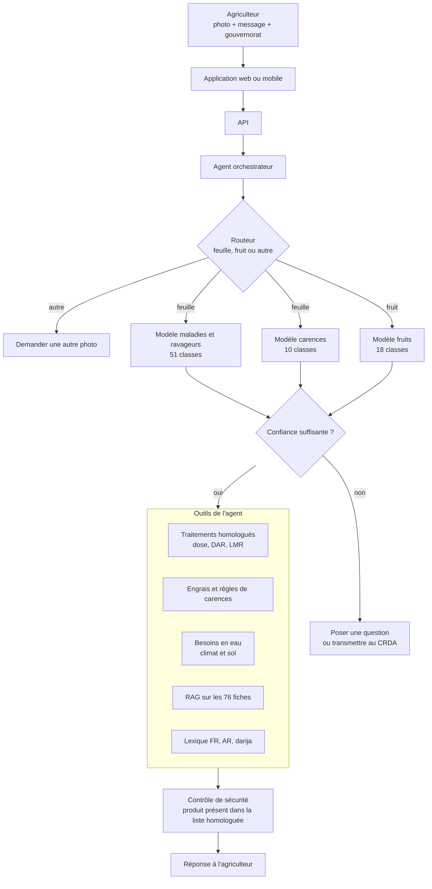

# AgrIA : architecture et répartition du travail

Ce document dit ce que nous construisons, qui fait quoi et dans quel ordre.
Les données sont prêtes. Il reste à construire les modèles, les outils de l'agent et l'application.

Le travail est **séquentiel** : chaque membre commence quand le précédent a livré ce qui est demandé dans sa section « Livré quand ».

| Étape | Responsable | Travail | Reçoit | Livre |
|---|---|---|---|---|
| 1 | **Maissene** | Socle d'entraînement + routeur | Données préparées | Données partagées, scripts `src/vision/`, routeur entraîné |
| 2 | **Nourhene** | Modèles de diagnostic | Scripts et données | 3 modèles entraînés, rapport d'évaluation |
| 3 | **Adem** | Outils de l'agent | Noms de classes, tables propres | Base de données, outils testés, RAG |
| 4 | **Abd Majid** | Agent, API, application | Modèles + outils | Application de démonstration, évaluation finale |

Les étapes 2 à 4 sont une proposition : l'équipe peut échanger les noms, pas l'ordre des étapes.

---

## 1. Vue d'ensemble



**Deux principes à ne jamais casser :**

1. **Le LLM ne choisit jamais un produit de lui-même.** Il ne peut citer qu'un produit renvoyé par l'outil de traitements. Le contrôle de sécurité vérifie cela en code, pas par une consigne au LLM.
2. **Dans le doute, l'agent ne recommande rien** : il pose une question ou transmet le cas au CRDA.

---

## 2. Organisation du dépôt

Ce qui existe déjà est marqué ✅. Le reste est à créer.

```text
AgrIA/
├── src/
│   ├── acquisition/      ✅ inventaire des images
│   ├── preparation/      ✅ collecte, nettoyage, équilibrage, EDA
│   ├── vision/           Étape 1 et 2 : entraînement et prédiction
│   │   ├── dataset.py       lecture des manifests, transformations
│   │   ├── train.py         entraînement d'une tâche
│   │   ├── evaluate.py      scores globaux, par classe, par culture, terrain
│   │   └── predict.py       interface utilisée par l'agent
│   ├── tools/            Étape 3 : outils de l'agent
│   │   ├── build_db.py      CSV propres vers base SQLite
│   │   ├── treatments.py    traitements homologués, dose, DAR, LMR
│   │   ├── fertilizers.py   engrais et règles de carences
│   │   ├── water.py         besoins en eau, prévisions météo
│   │   ├── rag.py           recherche dans les fiches
│   │   ├── lexicon.py       français, arabe, darija
│   │   └── safety.py        contrôle de la réponse finale
│   ├── agent/            Étape 4 : orchestrateur
│   ├── api/              Étape 4 : API
│   └── app/              Étape 4 : interface
├── tests/                un dossier de tests par module
├── docs/                 ✅ rapports, figures, tables de correspondance
├── data/                 ✅ hors Git, archive partagée par Drive, copiée sur chaque machine
└── models/               hors Git, archive partagée par Drive, copiée sur chaque machine
```

---

## 3. Données disponibles

Le dossier `data/` n'est **pas sur GitHub**. Il est partagé par Google Drive à l'étape 1, puis copié dans le dépôt de chaque membre. **Tout s'exécute en local** (GPU NVIDIA si disponible, sinon CPU), pas sur Colab.

| Besoin | Fichier | Contenu |
|---|---|---|
| Train | `data/processed/balanced/<tâche>_train.csv` | Train équilibré des tâches `diseases`, `deficiency`, `fruits` |
| Poids des classes | `data/processed/balanced/<tâche>_class_weights.csv` | Pour la fonction de perte |
| Validation et test | `data/processed/<tâche>_manifest.csv` | Colonne `split` : `val`, `test`, et `test_field` pour les maladies |
| Routeur | `data/processed/routing_manifest.csv` | 15 985 photos, classes `leaf`, `fruit`, `other` |
| Test par culture | `data/processed/balanced/deficiency_test_by_crop.csv` | Mesure du biais des carences |
| Traitements | `data/processed/clean/classe_traitements.csv` | Classe du modèle vers produit homologué |
| Réglementation | `data/processed/clean/pesticides_usages.csv`, `pesticides_usage_lmr.csv`, `eu_mrl.csv` | Usages, doses, LMR |
| Engrais | `data/processed/clean/carence_engrais.csv`, `engrais_catalogue.csv`, `engrais_usages.csv` | Carence vers engrais, composition, doses |
| Règles de carences | `data/processed/knowledge/regles_carences.json` | Questions de confirmation, règle de sol |
| Connaissances | `data/processed/knowledge/fiches.jsonl`, `lexique.csv`, `varietes_tn.csv` | RAG, langue, variétés |
| Contexte | `data/processed/context/` | Gouvernorats, climat, sols, besoins en eau |

**Règles sur les données**

- Ne jamais lancer `prepare_images.py` : il reconstruit tout et annule les retraits d'images.
- Ajouter une source uniquement avec `add_source.py`, retirer une image uniquement avec `remove_images.py`.
- Ne jamais modifier à la main une ligne d'un manifest.
- Ne pas ajouter d'images d'autres cultures pour corriger un biais.
- Ne jamais équilibrer la validation ni le test : ils gardent la distribution réelle.

---

## 4. Contrats entre les étapes

Ces interfaces permettent à chacun de travailler sans dépendre du code interne des autres. Toute modification se décide avec le membre concerné.

### Modèle vers agent : `src/vision/predict.py`

```python
predict(task: str, image_path: str) -> dict
# task : "routing", "diseases", "deficiency" ou "fruits"
# {
#   "task": "diseases",
#   "class": "tomato__late_blight",
#   "confidence": 0.93,
#   "top3": [["tomato__late_blight", 0.93], ["tomato__early_blight", 0.04], ...],
#   "reliable": True          # confiance au-dessus du seuil calibré
# }
```

Chaque modèle est livré dans `models/<tâche>/` avec `model.pt`, `labels.json` et `metrics.json`.
`labels.json` utilise exactement les noms de classes des manifests.

### Outils vers agent : `src/tools/`

```python
get_treatments(unified_class: str, crop: str | None) -> list[dict]
# produit, substances, dose, unité, DAR ou None, LMR, relation, restriction
get_fertilizers(deficiency: str) -> dict
# produits, teneur, dose, niveau de fiabilité, questions de confirmation
get_water_need(governorate: str, crop: str, month: int) -> dict
# ET0, Kc, besoin, pluie, déficit
search_knowledge(query: str, k: int = 3) -> list[dict]
# extrait, fiche, lien de la source
normalize_terms(text: str) -> dict
# cultures et symptômes reconnus en français, arabe, darija, arabizi
check_answer(answer: dict) -> dict
# valide ou bloque la réponse finale
```

Une liste vide veut dire « aucun produit homologué », jamais une erreur.

### API vers application

```text
POST /diagnose
  entrée : photo, message, gouvernorat, culture (facultative), langue
  sortie : diagnostic, confiance, recommandation, sources, question ou transmission au CRDA
```

---

## 5. Travail de chaque membre

### Étape 1 · Maissene : socle d'entraînement et routeur

**Objectif :** n'importe quel membre peut entraîner un modèle avec une seule commande.

1. **Partager les données.** Déposer `data/processed/` sur Google Drive, sous forme d'archive, avec les droits pour l'équipe.
2. **Rendre les données lisibles sur toute machine.** Les chemins des manifests et de `balanced/*_train.csv` utilisent `\` (Windows) et ne fonctionnent pas tels quels sous Linux ou macOS. Les convertir à la lecture dans `dataset.py`, sans modifier les fichiers.
3. **Écrire `src/vision/dataset.py`** : lecture des CSV, transformations et normalisation identiques partout, sans augmentation supplémentaire qui change les teintes.
4. **Écrire `src/vision/train.py`** : `python src/vision/train.py --task routing --model efficientnet_b0`. Il doit gérer le modèle préentraîné, les poids de classes, l'arrêt anticipé et la graine fixe.
5. **Écrire `src/vision/evaluate.py`** : exactitude, macro-F1, matrice de confusion, scores par classe, par culture et sur `test_field`.
6. **Écrire `src/vision/predict.py`** selon le contrat ci-dessus.
7. **Entraîner et évaluer le routeur** : c'est le test de toute la chaîne.
8. **Mettre à jour `requirements.txt`** (`torch`, `torchvision`, `scikit-learn`, `tqdm`) avec la commande d'installation de PyTorch pour GPU NVIDIA (CUDA 12.6).

**Attention :** 92 % des fruits du routeur sont des grenades. Regarder le score sur les fruits de tomate et d'agrumes, pas seulement le score global.

**Livré quand :**
- [ ] Nourhene relance l'entraînement du routeur sur sa machine, sans aide, avec une seule commande.
- [x] `models/routing/` contient `model.pt`, `labels.json`, `metrics.json`.
- [x] `predict("routing", "photo.jpg")` renvoie le format du contrat.
- [x] Les scores du routeur sont notés dans `docs/results_routing.md`.

### Étape 2 · Nourhene : modèles de diagnostic

**Objectif :** trois modèles évalués honnêtement, surtout sur le terrain.

1. Entraîner dans cet ordre : `diseases`, `deficiency`, `fruits`.
2. Comparer un CNN (EfficientNet) et un ViT sur `diseases`, puis garder le meilleur compromis entre score et vitesse.
3. Comparer avec et sans jeu équilibré (hypothèse H3).
4. Mesurer le score sur les 199 photos de `test_field` (H1).
5. Mesurer les carences par culture avec `deficiency_test_by_crop.csv` (H2).
6. Calibrer le seuil de confiance de chaque modèle, qui alimente le champ `reliable`.

**Critères visés :** exactitude d'au moins 90 % sur le terrain, macro-F1 d'au moins 0,85. Si la cible n'est pas atteinte, le rapport le dit et propose une suite, comme le prévoit la boucle CRISP-DM.

**Livré quand :**
- [ ] `models/diseases/`, `models/deficiency/`, `models/fruits/` sont sur le Drive.
- [ ] `predict()` fonctionne pour les quatre tâches.
- [ ] `docs/results_vision.md` donne les scores globaux, par classe, par culture et terrain, avec les hypothèses H1 à H3.
- [ ] Les seuils de confiance sont justifiés dans ce rapport.

### Étape 3 · Adem : outils de l'agent

**Objectif :** des outils fiables, sans LLM, testés un par un.

1. `build_db.py` : charger les tables propres dans une base SQLite.
2. `treatments.py` : traitements par classe et culture, en préférant les liens `direct`, puis `vecteur`, `groupe` et `proche`.
3. `fertilizers.py` : engrais par carence, avec `regles_carences.json` et le pH du gouvernorat.
4. `water.py` : besoins en eau à partir de `besoins_eau_mensuels.csv`, prévisions avec `forecast_url()` de `fetch_context_tn.py`.
5. `rag.py` : index Chroma des fiches, chaque extrait gardant le lien de sa source.
6. `lexicon.py` : reconnaissance des termes. Les 88 entrées marquées `a_valider` sont relues avec un locuteur tunisien.
7. `safety.py` : bloquer toute réponse citant un produit hors de la liste homologuée.

**Cas à traiter explicitement :**
- 28 classes sur 48 n'ont aucun produit homologué : donner des conseils tirés des fiches, jamais un produit inventé.
- Le DAR manque pour 88 % des usages : répondre « délai non précisé, voir l'étiquette », ne jamais l'estimer.
- Zn, B et Ca ne sont vus que sur une culture, Fe presque uniquement sur le poivron : sur une autre culture, le résultat reste une hypothèse à confirmer.
- Respecter les colonnes `restriction` et `autorisation_provisoire`.

**Livré quand :**
- [ ] Toutes les fonctions du contrat existent et ont des tests dans `tests/tools/`.
- [ ] Les cas ci-dessus ont chacun leur test.
- [ ] Un test vérifie que `safety.py` bloque un produit non homologué.
- [ ] Abd Majid peut appeler chaque outil sans connaître la base.

### Étape 4 · Abd Majid : agent, API, application

**Objectif :** une démonstration complète, de la photo à la réponse.

1. **Décider et noter dans ce fichier :** web ou mobile, choix du LLM.
2. `src/agent/` : orchestrateur qui suit le schéma de la section 1.
3. `src/api/` : `POST /diagnose`.
4. `src/app/` : prise de photo, message, gouvernorat, réponse en darija, français ou arabe.
5. Importer le jeu de test de l'agent préparé par Maissene et mesurer le système complet.
6. Organiser le pilote : au moins 10 agriculteurs ou conseillers.

**Critères visés :** moins de 15 s de la photo à la réponse, 100 % de produits homologués, au moins 70 % de réponses jugées utiles.

**Livré quand :**
- [ ] Une photo réelle donne une réponse complète dans l'application.
- [ ] Une photo hors sujet et une photo douteuse sont bien gérées.
- [ ] `docs/results_agent.md` donne les mesures finales.
- [ ] La démonstration tourne sur une autre machine que celle du développeur.

---

## 6. Règles de passage entre les étapes

1. Le responsable coche sa liste « Livré quand » dans ce fichier.
2. Le membre suivant vérifie lui-même la livraison, sur sa machine.
3. S'il bloque, il renvoie un problème précis. Le responsable précédent corrige avant la suite.
4. Si un résultat montre un problème de données, on revient à la préparation, puis on note la décision dans ce fichier.

**Git :** une branche par étape (`step1-vision-base`, etc.), une pull request relue par le membre suivant, et jamais de données ni de modèles dans Git.

---

## 7. Décisions ouvertes

| Décision | Responsable | État |
|---|---|---|
| Application web ou mobile | Abd Majid, avec l'équipe | À décider à l'étape 4 |
| Choix du LLM | Abd Majid, avec l'équipe | À décider à l'étape 4 |
| Dates de chaque étape | Équipe | À remplir |
| Validation des 88 termes en darija | Adem | À faire à l'étape 3 |
| Jeu de test de l'agent | Maissene | À importer avant l'étape 4 |
| Photos de terrain tunisiennes | Équipe | En continu, si possible |
