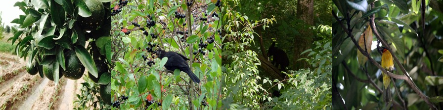

# Résultats du routeur (étape 1)

Le routeur lit une photo et décide quel modèle l'analyse : **leaf** (feuille → maladies et carences), **fruit** (fruit → modèle fruits) ou **other** (pas une plante utile → la photo est refusée).

## Entraînement

| Élément | Valeur |
|---|---|
| Machine | locale, NVIDIA GeForce RTX 2050 (4 Go), CUDA 12.6 |
| Modèle | EfficientNet-B0 préentraîné sur ImageNet (5,3 M paramètres) |
| Données | `data/processed/routing_manifest.csv` : train 11 367 · val 2 314 · test 2 234 · test_field 70 |
| Réglages | AdamW lr 3e-4, weight decay 0,05, cosinus, batch 32, perte pondérée par classe, précision mixte, graine 42 |
| Arrêt | anticipé sur la macro-F1 de validation, patience 4 |
| Durée | 7 époques, environ 10 minutes (la 1re époque est plus lente car les images passent du disque au cache) |
| Meilleure époque | 3 : val exactitude 0,9978 · val macro-F1 0,9979 |

Commande : `python src/vision/train.py --task routing`

## Évaluation

Commande : `python src/vision/evaluate.py --task routing`

| Jeu | Images | Exactitude | Macro-F1 | Confiance moyenne (juste / fausse) |
|---|---|---|---|---|
| test | 2 234 | **0,9982** | **0,9981** | 0,9996 / 0,8603 |
| test_field (photos réelles PlantDoc) | 70 | **1,000** | 1,000 | 0,9908 / — |

Matrice de confusion sur test (lignes = vraie classe) :

| | fruit | leaf | other |
|---|---|---|---|
| **fruit** | 832 | 1 | 0 |
| **leaf** | 0 | 732 | 0 |
| **other** | 0 | 3 | 666 |

### Fruits de tomate et d'agrumes

92 % des fruits du routeur sont des grenades, d'où ce contrôle par source :

| Source | Images | Exactitude |
|---|---|---|
| pomegranate | 765 | 1,000 |
| tomato_fruit | 46 | 1,000 |
| citrus_fruit | 22 | 0,955 (1 erreur) |

Le déséquilibre ne fait pas oublier les tomates et les agrumes. Le petit nombre d'agrumes (22) rend toutefois ce score fragile.

## Les 4 erreurs



1. Oranges vertes (citrus greening) presque cachées dans le feuillage → prédit `leaf` (confiance 0,71).
2. à 4. Photos COCO d'oiseaux au milieu des feuilles, classées `other` → prédit `leaf` (0,85 à 0,997).

Ces photos contiennent surtout des feuilles. Elles sont ambiguës et ne montrent pas de défaut du modèle. Dans l'application, une photo d'arbre envoyée au modèle des feuilles reste sans danger : ce modèle aura son propre seuil de confiance (étape 2).

## Seuil de confiance

Le seuil a été calibré à l'étape 2 avec `src/vision/calibrate.py` : **0,5**, le plancher de la règle, car le routeur se trompe très rarement. Sur test comme sur test_field, toutes les photos sont gardées.

## Contrat `predict()`

```
python src/vision/predict.py routing data/processed/routing/test/leaf/<image>.jpg
{"task": "routing", "class": "leaf", "confidence": 1.0,
 "top3": [["leaf", 1.0], ["fruit", 0.0], ["other", 0.0]], "reliable": true}
```

## Fichiers produits (hors Git, dans `models/routing/`)

`model.pt` (poids + architecture + classes), `labels.json`, `metrics.json` (historique), `train.log`, `eval_test.json`, `eval_test_field.json`, `confusion_*.csv`, `predictions_*.csv`.
